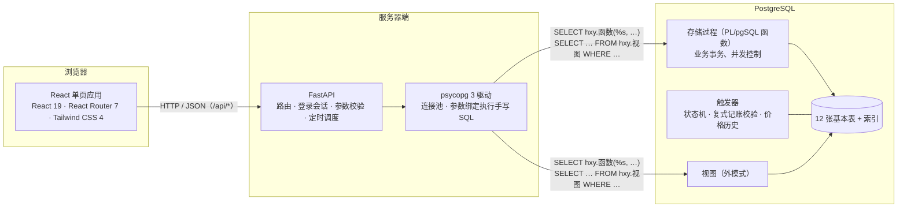
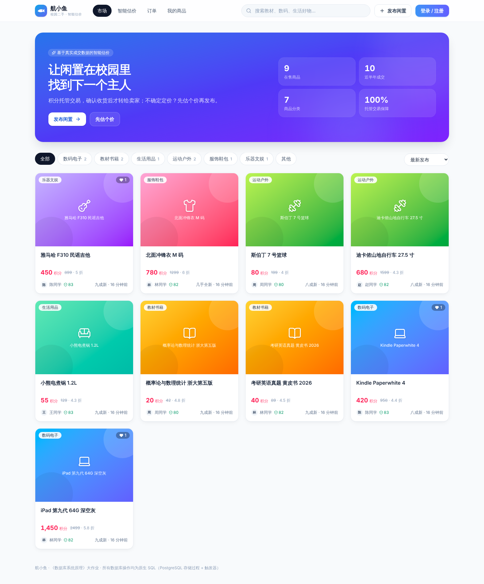
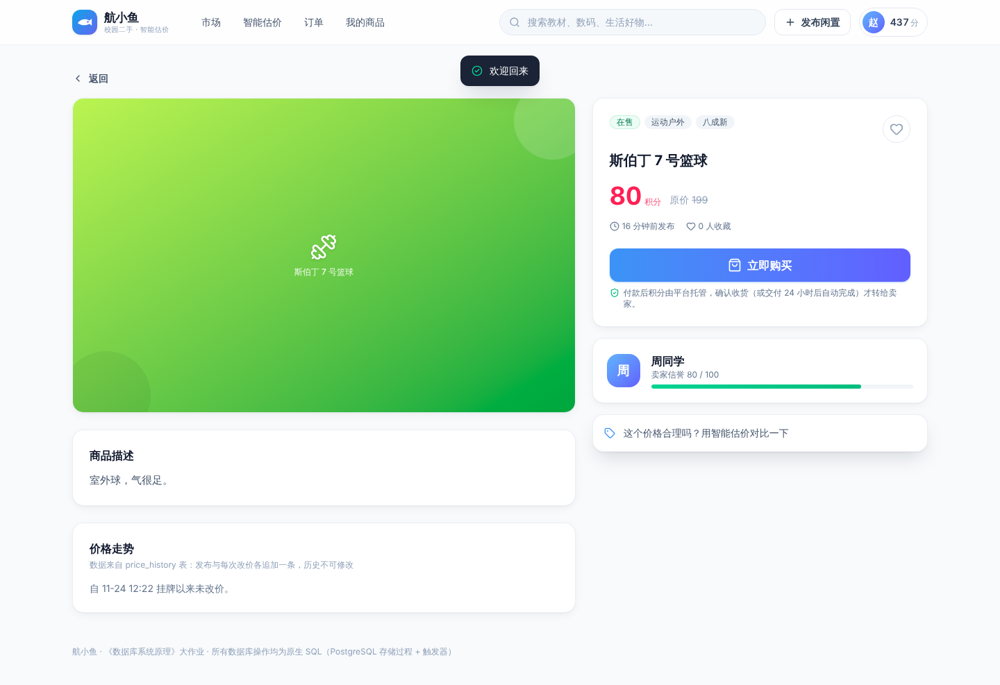
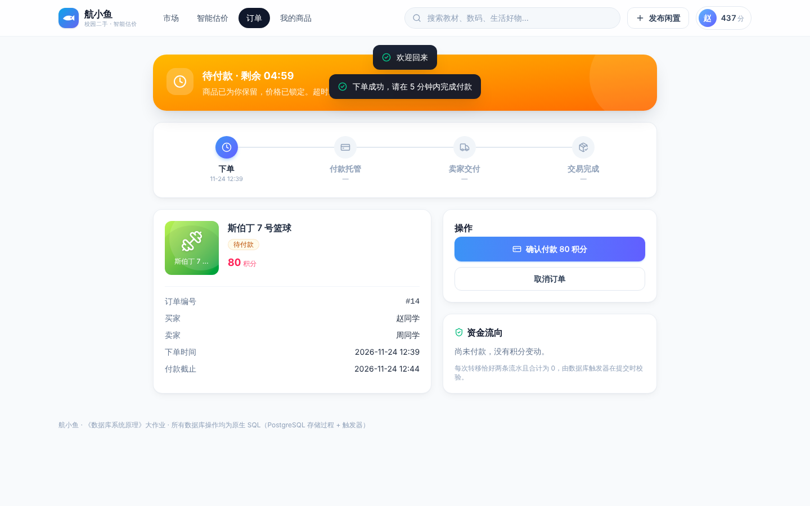
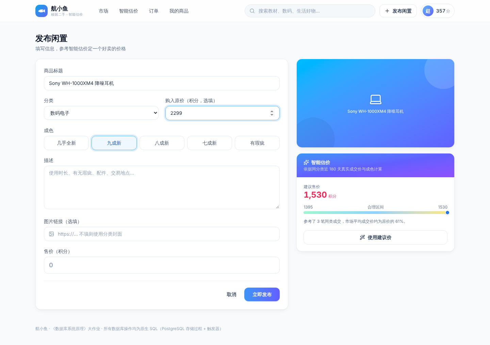
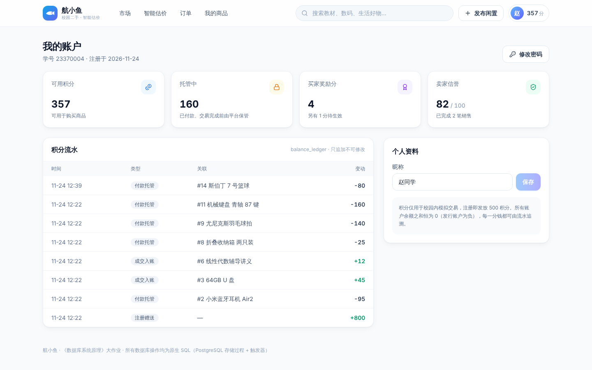
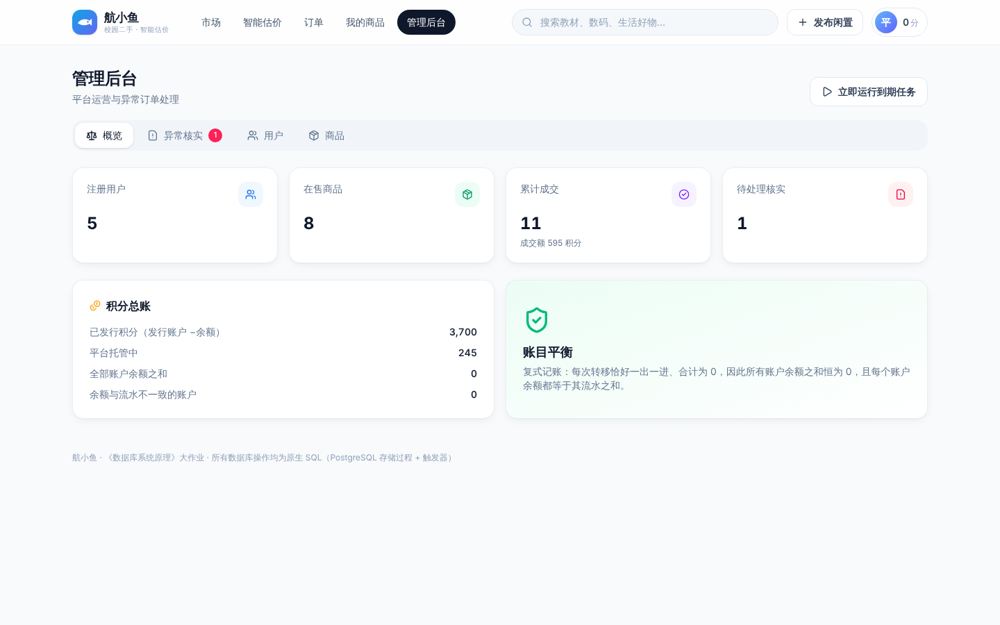

# 《数据库系统原理》大作业 · 系统实现报告

**题目名称：** 航小鱼 —— 校园二手交易与智能估价平台

**学号及姓名：** ______________________（组长）　______________________　______________________

**日期：** 2026 年 ___ 月 ___ 日

---

## 一、系统总体架构设计

### 1. 架构



三层职责划分：

| 层 | 技术 | 职责 | 是否接触数据库 |
| --- | --- | --- | --- |
| 客户端 | React + Vite + Tailwind CSS | 页面渲染、交互、倒计时显示 | 否，只调用 HTTP 接口 |
| 服务器端 | Python FastAPI + psycopg | 路由、登录会话（签名 Cookie）、请求参数校验、把数据库错误翻译成提示、每 30 秒调用一次定时任务函数 | 只通过 psycopg 发送**手写的原生 SQL 字符串** |
| 数据库 | PostgreSQL 16 / 18 | 全部数据定义、约束、业务规则、事务与并发控制 | — |

**关于"必须使用原生 SQL"的说明。** 本项目的建库、建表、约束、索引、触发器、存储过程、视图全部是手写的 SQL 脚本（`db/01~08`）；服务器端所有增删改查都是写在代码里的 SQL 字符串，例如：

```python
# backend/app/routers/orders.py
fetch_value("SELECT hxy.pay_order(%s, %s)", (order_id, user["user_id"]))

# backend/app/routers/listings.py
execute("DELETE FROM hxy.favorite WHERE user_id = %s AND listing_id = %s", (user["user_id"], listing_id))
```

没有使用任何 ORM（没有模型类、没有查询构造器、没有框架生成的迁移）。psycopg 只承担数据库驱动的职责：建立连接，把 SQL 文本和参数发给 PostgreSQL，取回结果行。所有用户输入都通过 `%s` 参数绑定传入，不拼接到 SQL 文本中（测试 `test_search_is_parameterized` 用典型的注入字符串验证过）。

### 2. 开发与运行环境

| 项目 | 版本 |
| --- | --- |
| 数据库 | PostgreSQL 18（组内开发）；PostgreSQL 16 上同样通过全部测试 |
| 服务器端 | Python 3.11+，FastAPI 0.165，uvicorn 0.54，psycopg 3.3，psycopg-pool 3.3 |
| 客户端 | Node.js 20+，React 19，React Router 7，Vite 8，Tailwind CSS 4，lucide-react 图标 |
| 测试 | `db/run_tests.py`（115 项数据库检查 + 并发测试）、pytest API 测试、Playwright 端到端测试 |

### 3. 目录结构

```text
db/                   数据库（原生 SQL）
  01_schema.sql         基本表与约束
  02_indexes.sql        查询索引（物理设计）
  03_triggers.sql       触发器
  04~07_functions_*.sql 存储过程：用户、商品、估价、交易
  08_views.sql          视图
  09_seed.sql           演示数据（全部通过存储过程写入）
  install.sql           psql 一键安装 01~08
  run_tests.py          跨平台隔离测试
  tests/                SQL 测试用例
backend/app/          FastAPI 服务器端（db.py 为数据库访问层）
frontend/src/         React 客户端
docs/                 设计报告、实现报告、E-R 图、SQL 演示及运行结果
legacy/               早期独立交易模块（保留作过程记录）
```

---

## 二、数据库基本表的定义

完整 DDL 见 `db/01_schema.sql`。以订单表为例：

```sql
CREATE TABLE hxy.trade_order (
    order_id              BIGINT GENERATED ALWAYS AS IDENTITY PRIMARY KEY,
    listing_id            BIGINT      NOT NULL REFERENCES hxy.listing (listing_id),
    buyer_id              BIGINT      NOT NULL REFERENCES hxy.app_user (user_id),
    price_snapshot_points BIGINT      NOT NULL,
    status                VARCHAR(20) NOT NULL,
    created_at            TIMESTAMPTZ NOT NULL,
    payment_deadline_at   TIMESTAMPTZ NOT NULL,
    paid_at               TIMESTAMPTZ,
    delivered_at          TIMESTAMPTZ,
    auto_complete_at      TIMESTAMPTZ,
    completed_at          TIMESTAMPTZ,
    completion_method     VARCHAR(20),
    canceled_at           TIMESTAMPTZ,
    cancel_reason         VARCHAR(30),
    CONSTRAINT trade_order_price_check CHECK (price_snapshot_points > 0),
    CONSTRAINT trade_order_status_check CHECK (status IN
        ('PENDING_PAYMENT', 'PENDING_DELIVERY', 'PENDING_RECEIPT',
         'UNDER_REVIEW', 'COMPLETED', 'CANCELED', 'PAYMENT_EXPIRED')),
    CONSTRAINT trade_order_completion_together CHECK ((completed_at IS NULL) = (completion_method IS NULL)),
    CONSTRAINT trade_order_completed_shape CHECK (
        status <> 'COMPLETED' OR (paid_at IS NOT NULL AND delivered_at IS NOT NULL AND completed_at IS NOT NULL))
    -- 其余约束略
);

-- 同一商品同时最多一笔有效订单
CREATE UNIQUE INDEX trade_order_one_active_per_listing ON hxy.trade_order (listing_id)
    WHERE status IN ('PENDING_PAYMENT', 'PENDING_DELIVERY', 'PENDING_RECEIPT', 'UNDER_REVIEW');
```

全部基本表一览：

| 表 | 主键 | 外键 | 主要约束 |
| --- | --- | --- | --- |
| app_user 用户 | user_id | — | 学号唯一且格式校验；role ∈ {USER, ADMIN}；status ∈ {ACTIVE, BANNED} |
| category 分类 | category_id | — | 名称唯一 |
| listing 商品 | listing_id | seller_id → app_user，category_id → category | 成色 1~5；价格 > 0；状态取值 |
| favorite 收藏 | (user_id, listing_id) | → app_user，→ listing（级联删除） | — |
| valuation 估价记录 | valuation_id | requester_id → app_user，category_id → category | 0 < 最低 ≤ 建议 ≤ 最高 |
| point_account 积分账户 | account_id | user_id → app_user | 账户类型与 user_id 是否为空相互匹配；除发行账户外余额 ≥ 0；平台账户各一个 |
| trade_order 订单 | order_id | listing_id → listing，buyer_id → app_user | 见上 |
| point_transfer 积分转移 | transfer_id | order_id → trade_order | GRANT 与 order_id 为空互为充要；(订单, 事件) 唯一；结算 / 退款二选一 |
| balance_ledger 积分流水 | ledger_id | transfer_id → point_transfer，account_id → point_account | 变动 ≠ 0；(转移, 账户) 唯一 |
| price_history 价格历史 | history_id | listing_id → listing（级联删除） | 每商品一条 INITIAL |
| order_review 核实单 | review_id | order_id → trade_order，admin_id → app_user | 结论、处理时间、管理员同时为空或同时非空；每订单至多一条未处理 |
| score_event 评分事件 | score_event_id | order_id、user_id、operator_id | (订单, 类型, 原因) 唯一 |

---

## 三、触发器与存储过程的设计与实现说明

### 1. 设计原则

- **存储过程负责"流程"**：一次业务操作（例如付款）= 一次 `SELECT hxy.函数(...)` 调用 = 一个事务。函数内部先加锁、再检查、最后写入，任何一步 `RAISE EXCEPTION` 都使整个调用回滚。
- **触发器负责"不变量"**：无论数据从哪里写入（存储过程、管理员手工 SQL）都必须成立的规则。
- **统一锁顺序防死锁**：订单 → 商品 → 积分账户（按 account_id 升序）→ 用户。

### 2. 触发器

| 触发器 | 时机 | 作用 |
| --- | --- | --- |
| T1 user_open_account | AFTER INSERT ON app_user | 新用户自动开设积分账户 |
| T2 listing_before_update | BEFORE UPDATE ON listing | 维护 updated_at；禁止修改卖家归属 |
| T3 listing_initial_price / listing_reprice_history | AFTER INSERT / AFTER UPDATE OF current_price_points | 发布写 INITIAL、改价写 REPRICE —— 价格历史的唯一写入路径 |
| T3' price_history_guard | BEFORE UPDATE OR DELETE ON price_history | 历史不可修改；只有所属商品已删除（级联）时才允许删除 |
| T4 order_state_machine | BEFORE UPDATE ON trade_order | 订单状态机：只允许合法转换；终态订单不可修改；价格快照、商品、买家、期限不可修改 |
| T4' order_no_delete | BEFORE DELETE ON trade_order | 订单需保留审计，不可删除 |
| T5 transfer_complete_on_event / _on_ledger | AFTER INSERT，**DEFERRABLE INITIALLY DEFERRED** 约束触发器 | 在**事务提交时**检查每次转移恰有 2 条流水，账户、方向、金额与订单一致 |
| T5' transfer / ledger / score_event append_only | BEFORE UPDATE OR DELETE | 账务与评分记录只追加 |

T4 订单状态机的核心代码：

```sql
IF NEW.status <> OLD.status AND NOT (
       (OLD.status = 'PENDING_PAYMENT'  AND NEW.status IN ('PENDING_DELIVERY', 'CANCELED', 'PAYMENT_EXPIRED'))
    OR (OLD.status = 'PENDING_DELIVERY' AND NEW.status IN ('PENDING_RECEIPT', 'UNDER_REVIEW'))
    OR (OLD.status = 'PENDING_RECEIPT'  AND NEW.status IN ('COMPLETED', 'UNDER_REVIEW'))
    OR (OLD.status = 'UNDER_REVIEW'     AND NEW.status IN ('CANCELED', 'PENDING_DELIVERY', 'PENDING_RECEIPT'))
) THEN
    RAISE EXCEPTION '订单 % 不允许从 % 变为 %', OLD.order_id, OLD.status, NEW.status;
END IF;
```

T5 为什么用"延迟到提交时检查"：一次付款要依次插入 1 条转移和 2 条流水，插入第一条流水时另一条还不存在，如果立即检查一定失败。约束触发器 `DEFERRABLE INITIALLY DEFERRED` 让检查推迟到 COMMIT，此时整笔转移已经完整。

### 3. 存储过程

| 模块 | 函数 | 说明 |
| --- | --- | --- |
| 用户 | `register_user(学号, 昵称, 密码, 初始积分, 角色)` | 插入用户（T1 开户），并以 GRANT 转移从发行账户发放初始积分；密码用 pgcrypto `crypt(…, gen_salt('bf'))` 哈希 |
| | `authenticate(学号, 密码)` | 校验密码，返回用户编号或 NULL |
| | `change_password`、`set_user_status`、`assert_admin`、`assert_active_user` | 改密码；管理员封禁（同时下架其商品）；角色校验 |
| 商品 | `create_listing`、`update_listing_info`、`reprice_listing` | 发布、修改、改价（只在售 / 下架且无有效订单时可改价） |
| | `take_off_shelf`、`put_on_shelf`、`set_relist_blocked` | 上下架、管理员禁止再售 |
| | `delete_listing` | 只删除从未产生订单的商品，价格历史与收藏级联删除 |
| | `release_relist_buffers` | 定时任务：缓冲期满 24 小时自动恢复在售 |
| 估价 | `estimate_price(分类, 成色, 原价)` | 只计算不保存（见下） |
| | `create_valuation` | 计算并保存估价记录 |
| 交易 | `place_order(商品, 买家, 页面价格)` | 锁商品、清理过期占用、生成价格快照与 5 分钟期限 |
| | `pay_order(订单, 买家)` | 检查期限与余额，买家 → 托管，写 2 条流水 |
| | `cancel_unpaid_order`、`mark_order_delivered`、`complete_order` | 取消、交付、结算（托管 → 卖家，并写奖励与信誉） |
| | `open_order_review`、`resolve_order_review` | 发起核实；管理员取消（原额退款）或继续，可认定卖家超时（信誉 −10） |
| | `expire_unpaid_orders`、`complete_due_orders`、`open_late_delivery_reviews`、`run_scheduled_tasks` | 定时任务入口，使用 `FOR UPDATE SKIP LOCKED` 批量处理 |

**付款存储过程（节选）**：

```sql
SELECT * INTO v_order FROM hxy.trade_order WHERE order_id = p_order_id FOR UPDATE;   -- 1. 锁订单
IF v_order.buyer_id IS DISTINCT FROM p_buyer_id THEN RAISE EXCEPTION '只有订单 % 的买家可以付款', p_order_id; END IF;
IF v_order.status <> 'PENDING_PAYMENT' THEN RAISE EXCEPTION '订单 % 当前状态为 %，不能付款', … ; END IF;
v_paid_at := clock_timestamp();
IF v_paid_at >= v_order.payment_deadline_at THEN RAISE EXCEPTION '订单 % 已超过付款截止时间', p_order_id; END IF;
UPDATE hxy.listing SET status = 'TRADING' WHERE listing_id = v_order.listing_id AND status = 'PAYMENT_RESERVED';
PERFORM account_id FROM hxy.point_account                                            -- 2. 按编号顺序锁两个账户
 WHERE account_id IN (v_buyer_account_id, v_escrow_account_id) ORDER BY account_id FOR UPDATE;
-- 3. 检查余额 → 扣买家、加托管 → 写转移与两条流水 → 订单改为待交付
```

**智能估价算法**（`estimate_price`，纯 SQL 聚合）：

1. 成色基准折旧率：几乎全新 0.85、九成新 0.70、八成新 0.55、七成新 0.40、有瑕疵 0.25。
2. 取同分类、近 180 天、原价已知的已完成订单，计算每笔"成交价 ÷ 原价"，再按成色折算到目标成色：`比率 × 基准(目标成色) ÷ 基准(样本成色)`。
3. 用 `percentile_cont` 求中位数和 25%、75% 分位数。
4. 样本越多越相信市场：`w = n / (n + 5)`，最终比率 = `w × 市场中位数 + (1 − w) × 基准率`；建议价 = 原价 × 最终比率。

### 4. 并发控制

| 并发场景 | 数据库机制 | 测试 |
| --- | --- | --- |
| 两名买家同时下单同一商品 | `SELECT … FOR UPDATE` 锁商品行；部分唯一索引兜底 | `run_tests.py` 双会话：第二个会话等待约 2 秒后被拒绝 |
| 买家确认收货与"未收到"反馈同时提交 | 两者都先锁订单行，后到者看到已变化的状态 | 同上 |
| 重复付款 / 重复结算 / 结算与退款并发 | 唯一约束 (订单, 事件)、部分唯一索引"结算 / 退款二选一" | SQL 测试 |
| 定时任务多实例同时运行 | `FOR UPDATE SKIP LOCKED` 跳过已被锁定的订单 | — |

---

## 四、系统各项功能数据库端操作 SQL 语句与运行结果展示

以下结果由 `docs/sql_demo.sql` 在装有演示数据的库上执行得到，完整输出见 `docs/sql_demo_output.txt`。

### 1. 注册（插入）、登录（查询）、修改

```text
SELECT hxy.register_user('23370099', '演示同学', 'demo123') AS new_user_id;
SELECT hxy.authenticate('23370099', 'demo123') AS login_ok, hxy.authenticate('23370099', 'wrong') AS login_fail;
 login_ok | login_fail
----------+------------
        7 |

UPDATE hxy.app_user SET display_name = '演示同学A' WHERE user_id = 7;
UPDATE 1

SELECT event_type, delta_points FROM hxy.v_account_statement WHERE user_id = 7;
 event_type | delta_points
------------+--------------
 GRANT      |          500
```

### 2. 商品：发布、搜索、修改、改价、删除

```text
SELECT listing_id, title, category_name, condition_level, current_price_points, status, seller_name
  FROM hxy.v_listing_card WHERE status = 'ON_SALE' AND title ILIKE '%' || '鼠标' || '%' ORDER BY created_at DESC;
 listing_id |       title        | category_name | condition_level | current_price_points | status  | seller_name
------------+--------------------+---------------+-----------------+----------------------+---------+-------------
         23 | 罗技 G304 无线鼠标 | 数码电子      |               4 |                  120 | ON_SALE | 演示同学A

SELECT hxy.reprice_listing(23, 7, 110) AS new_history_id;
SELECT history_id, price_points, change_type FROM hxy.price_history WHERE listing_id = 23 ORDER BY history_id;
 history_id | price_points | change_type
------------+--------------+-------------
         23 |          120 | INITIAL
         24 |          110 | REPRICE

SELECT hxy.delete_listing(24, 7);       -- 删除一件未成交、且被收藏过的商品
SELECT (SELECT COUNT(*) FROM hxy.listing WHERE listing_id = 24) AS listing_left,
       (SELECT COUNT(*) FROM hxy.price_history WHERE listing_id = 24) AS history_left,
       (SELECT COUNT(*) FROM hxy.favorite WHERE listing_id = 24) AS favorite_left;
 listing_left | history_left | favorite_left
--------------+--------------+---------------
            0 |            0 |             0
```

### 3. 收藏与智能估价

```text
INSERT INTO hxy.favorite (user_id, listing_id) VALUES (2, 23) ON CONFLICT DO NOTHING;
DELETE FROM hxy.favorite WHERE user_id = 2 AND listing_id = 23;
DELETE 1

SELECT * FROM hxy.estimate_price(1, 4::SMALLINT, 249);
 suggested_price_points | low_price_points | high_price_points | sample_count | market_ratio
------------------------+------------------+-------------------+--------------+--------------
                    166 |              149 |               182 |            3 |       0.6076

SELECT * FROM hxy.v_category_market ORDER BY category_id;
 category_id |   name   | deals_180d | avg_deal_points | avg_deal_ratio | on_sale_count
-------------+----------+------------+-----------------+----------------+---------------
           1 | 数码电子 |          3 |              67 |          0.615 |             3
           2 | 教材书籍 |          3 |              20 |          0.374 |             2
           …
```

### 4. 交易主流程：下单 → 付款托管 → 交付 → 确认收货

```text
SELECT hxy.place_order(23, 2, 110) AS oid;                 -- 返回 14
SELECT order_id, status, price_snapshot_points, payment_deadline_at - created_at AS pay_window FROM hxy.trade_order WHERE order_id = 14;
 order_id |     status      | price_snapshot_points | pay_window
----------+-----------------+-----------------------+------------
       14 | PENDING_PAYMENT |                   110 | 00:05:00

SELECT hxy.pay_order(14, 2);
SELECT hxy.mark_order_delivered(14, 7);
SELECT hxy.complete_order(14, 'BUYER_CONFIRMED', 2);

SELECT t.event_type, a.owner_type, a.user_id, b.delta_points FROM hxy.point_transfer t
  JOIN hxy.balance_ledger b USING (transfer_id) JOIN hxy.point_account a USING (account_id)
 WHERE t.order_id = 14 ORDER BY b.ledger_id;
 event_type |   owner_type    | user_id | delta_points
------------+-----------------+---------+--------------
 PAYMENT    | USER            |       2 |         -110
 PAYMENT    | PLATFORM_ESCROW |         |          110
 SETTLEMENT | PLATFORM_ESCROW |         |         -110
 SETTLEMENT | USER            |       7 |          110
```

### 5. 数据库拒绝的非法操作

```text
SELECT hxy.complete_order(14, 'BUYER_CONFIRMED', 2);
ERROR:  订单 14 或商品状态不允许结算

SELECT hxy.pay_order(15, 6);
ERROR:  积分不足：余额 485，需要 1450

UPDATE hxy.balance_ledger SET delta_points = 0;
ERROR:  已记账的 balance_ledger 记录不可修改或删除

UPDATE hxy.trade_order SET status = 'COMPLETED' WHERE order_id = 15;
ERROR:  订单 15 不允许从 PENDING_PAYMENT 变为 COMPLETED

DELETE FROM hxy.listing WHERE listing_id = 23;
ERROR:  update or delete on table "listing" violates foreign key constraint "trade_order_listing_id_fkey"
```

### 6. 异常核实与退款

```text
SELECT review_id, reason, listing_title, buyer_name, seller_name, price_snapshot_points FROM hxy.v_open_reviews;
 review_id |        reason        |       listing_title        | buyer_name | seller_name | price_snapshot_points
-----------+----------------------+----------------------------+------------+-------------+-----------------------
         1 | BUYER_CANCEL_REQUEST | 数据结构（C 语言版）严蔚敏 | 周同学     | 赵同学      |                    15

SELECT hxy.resolve_order_review(1, 1, 'CANCEL', FALSE);
  status  |    cancel_reason     | listing_status
----------+----------------------+----------------
 CANCELED | BUYER_CANCEL_REQUEST | RELIST_BUFFER

 event_type | delta_points |   owner_type
------------+--------------+-----------------
 PAYMENT    |          -15 | USER
 PAYMENT    |           15 | PLATFORM_ESCROW
 REFUND     |          -15 | PLATFORM_ESCROW
 REFUND     |           15 | USER
```

### 7. 全平台对账与执行计划

```text
SELECT * FROM hxy.v_platform_stats;
 user_count | on_sale_count | completed_orders | completed_volume | escrow_balance | issued_points | open_reviews | balance_sum | mismatched_accounts
------------+---------------+------------------+------------------+----------------+---------------+--------------+-------------+---------------------
          6 |             8 |               11 |              625 |            230 |          4200 |            0 |           0 |                   0

EXPLAIN SELECT * FROM hxy.trade_order WHERE buyer_id = 2 ORDER BY order_id DESC;
 Index Scan using trade_order_buyer_idx on trade_order  (cost=0.15..8.17 rows=1 width=282)
   Index Cond: (buyer_id = 2)

EXPLAIN SELECT order_id FROM hxy.trade_order WHERE status = 'PENDING_PAYMENT' AND payment_deadline_at <= now();
 Index Scan using trade_order_payment_due_idx on trade_order  (cost=0.15..8.17 rows=1 width=8)
   Index Cond: (payment_deadline_at <= now())
```

### 8. 自动化测试结果

```text
$ python db/run_tests.py
RUN t01_user_account.sql … RUN t05_valuation.sql
RUN 并发测试
    √ 两名买家同时下单同一商品（第二个会话等待 1.9s 后被拒绝：ERROR:  商品 1 当前不是在售状态）
    √ 买家确认收货与未收到反馈同时提交（第二个会话等待 2.0s 后被拒绝）
RUN 09_seed.sql 演示数据
    √ 演示数据安装成功且账目平衡
PASS：全部 115 项检查通过。

$ pytest backend/tests
7 passed
```

---

## 五、系统前端开发技术

| 技术 | 用途 |
| --- | --- |
| React 19 + TypeScript | 组件化页面，类型检查接口数据 |
| React Router 7 | 单页应用路由；未登录访问受保护页面时跳转登录 |
| Tailwind CSS 4 | 原子化样式；自定义品牌色、卡片阴影等设计变量 |
| Vite 8 | 开发服务器（把 `/api` 转发到 FastAPI）与生产构建 |
| lucide-react | 图标 |

页面：市场首页（分类、搜索、排序、分页）、商品详情（价格走势图、卖家信誉、收藏、下单）、发布 / 管理商品（实时估价面板、改价、上下架、删除）、智能估价（估价、分类行情、估价记录）、我的订单（买到 / 卖出）、订单详情（进度条、倒计时、资金流向、核实记录）、我的账户（积分汇总、流水、改密码）、我的收藏、卖家主页、管理后台（统计与对账、异常核实、用户、商品与分类）。界面同时适配电脑和手机（手机端底部导航）。

倒计时以服务器时间为准：接口返回 `server_time`，前端用它与本地时钟的差值校正；但前端倒计时只用于显示，付款是否超时**始终由数据库函数判断**。

| 市场首页 | 商品详情 |
| --- | --- |
|  |  |
| **订单待付款** | **发布商品与智能估价** |
|  |  |
| **我的账户与积分流水** | **管理后台** |
|  |  |

---

## 六、组员大作业总结

> 小组内每位同学对所承担任务完成情况进行总结，包括任务内容概述、任务的难点以及解决难点的方法、任务完成结果、收获与体会。

**同学 1（组长）：**

**同学 2：**

**同学 3：**
