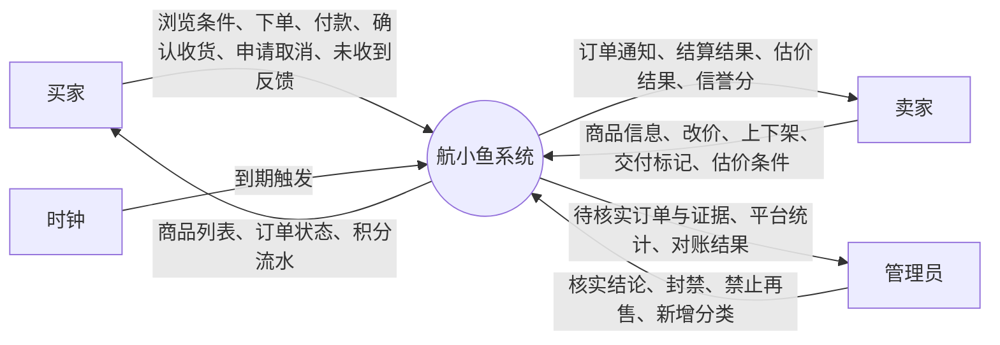
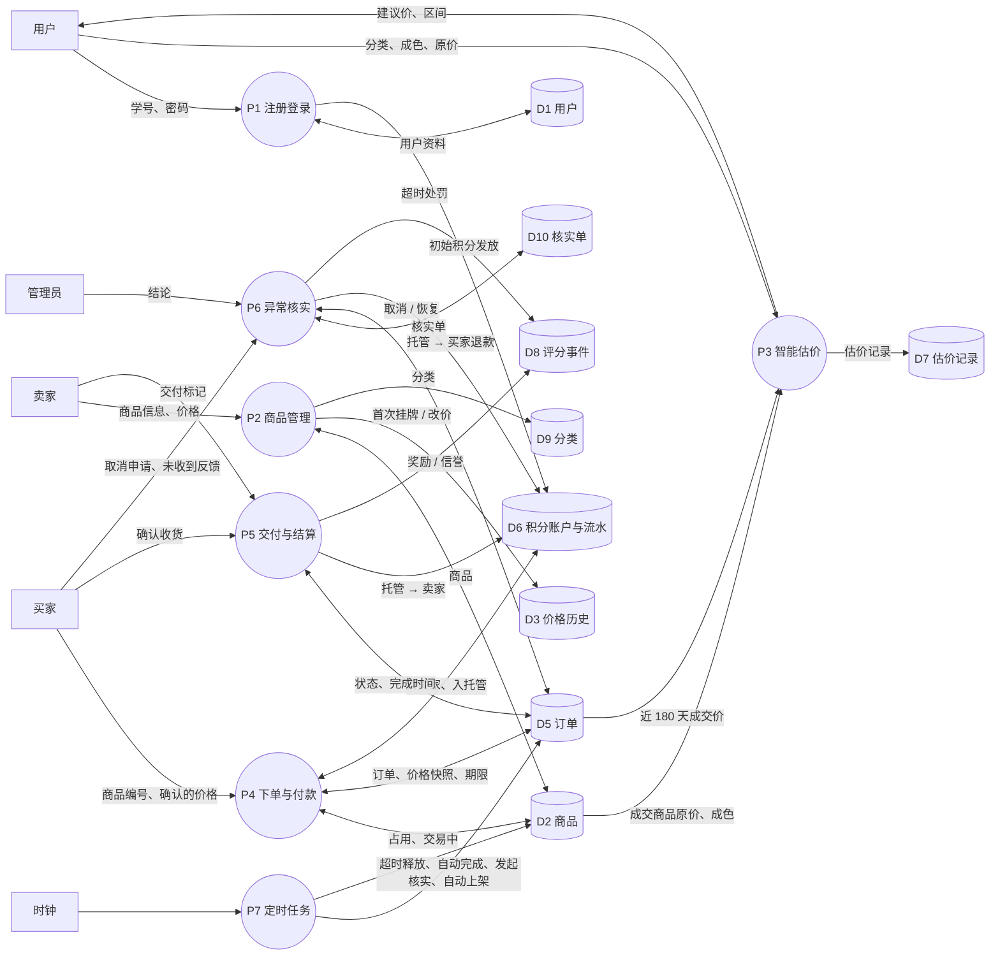
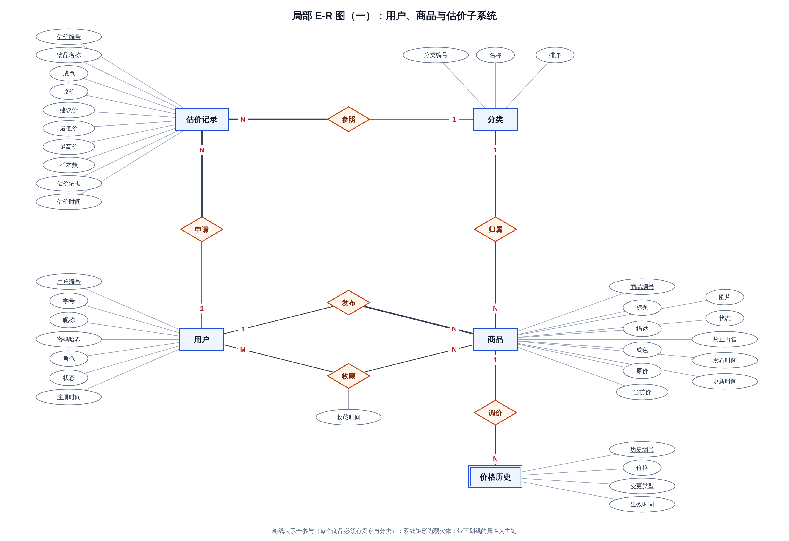
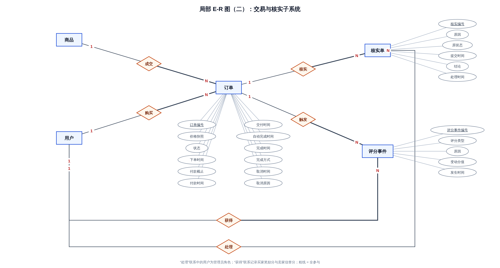
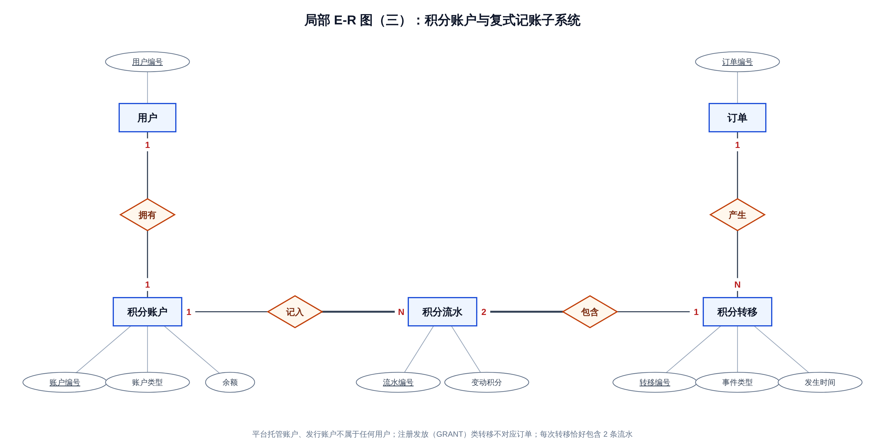
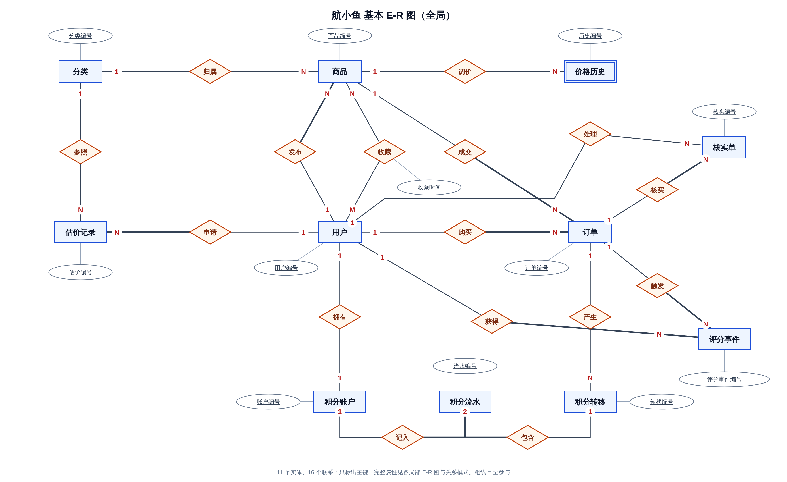

# 《数据库系统原理》大作业 · 系统设计报告

**题目名称：** 航小鱼 —— 校园二手交易与智能估价平台

**学号及姓名：** ______________________（组长）　______________________　______________________

**日期：** 2026 年 ___ 月 ___ 日

---

## 组内同学承担任务说明

> 由小组按实际分工填写；工作量占比三人合计为 1。

| 任务与工作量占比 | XXX（组长） | XXX | XXX |
| --- | --- | --- | --- |
| 任务 1：系统需求分析 | | | |
| 任务 2：数据库设计 | | | |
| 任务 3：系统总体架构设计 | | | |
| 任务 4：系统服务器端开发 | | | |
| 任务 5：系统客户端开发 | | | |
| 整体工作量占比 | | | |

---

## 一、需求分析

### 1. 需求描述

校园里每到毕业季、学期末都会产生大量闲置物品（教材、数码产品、生活用品等），线上群聊交易存在信息分散、定价随意、付款后不发货等问题。「航小鱼」为在校学生提供一个以**演示积分**结算的二手交易平台：

1. **用户**以学号注册登录，注册时获得 500 演示积分；同一用户既可以买也可以卖。管理员负责处理交易纠纷、封禁违规账号、维护商品分类。
2. **卖家**发布闲置商品（标题、分类、成色、原价、售价、描述、图片），可以修改信息、改价、上下架；从未产生过订单的商品可以删除。每次定价和改价都要留下**价格历史**。
3. **买家**浏览、搜索、按分类筛选、收藏商品；下单后商品为其保留 5 分钟并锁定价格，期限内付款。
4. **托管交易**：付款后积分先进入平台托管账户；卖家标记交付后，买家确认收货（或交付满 24 小时自动完成）时，托管积分才转给卖家。卖家 48 小时内未交付、买家申请取消、买家反馈未收到商品时，订单进入**管理员核实**，由管理员决定原额退款或继续交易。
5. **信誉与奖励**：每完成一笔交易，买家奖励分 +1，卖家信誉分 +1；经管理员确认超时未交付的卖家信誉分 −10。信誉分初始 80，范围 0~100。奖励分、信誉分都不能用于购买。
6. **智能估价**：用户输入物品分类、成色和原价，系统根据平台上同分类近 180 天**真实成交价**估算建议售价和合理区间，可保存估价记录，也可以在发布商品时实时参考。
7. **可审计**：所有积分变动都采用复式记账（一出一进、合计为 0），订单、流水、价格历史、评分记录只追加、不删除，任何时刻都能对账。

### 2. 系统功能设计

```text
航小鱼
├── 用户管理 ─── 注册（发放初始积分）· 登录 / 退出 · 修改昵称 · 修改密码 · 卖家主页
├── 商品管理 ─── 发布 · 修改信息 · 改价（写价格历史）· 下架 / 上架 · 删除（未成交）
│               · 搜索 / 分类筛选 / 排序 · 商品详情与价格走势 · 收藏 / 取消收藏
├── 智能估价 ─── 实时估价 · 保存估价记录 · 查看 / 删除估价记录 · 分类行情统计
├── 交易管理 ─── 下单（价格快照、5 分钟占用）· 付款托管 · 取消未付款订单
│               · 卖家交付 · 确认收货 · 申请取消 · 反馈未收到 · 我的订单
├── 积分账户 ─── 可用 / 托管 / 奖励 / 信誉汇总 · 积分流水
├── 个人看板 ─── 待办事项 · 余额走势 · 近 30 天收支 · 交易统计 · 商品状态分布
├── 后台管理 ─── 运营看板（每日成交额 / 新订单、订单状态分布、分类与卖家排行、即将超时订单）
│               · 平台统计与对账 · 异常核实（退款 / 继续、认定超时）
│               · 封禁 / 解封用户 · 禁止再售 · 新增分类
└── 定时任务 ─── 付款超时释放 · 自动确认收货 · 交付超时发起核实 · 缓冲期满自动上架
```

| 功能 | 查询 | 插入 | 修改 | 删除 |
| --- | :-: | :-: | :-: | :-: |
| 用户 | 登录、个人信息、卖家主页 | 注册 | 昵称、密码、封禁状态 | — |
| 商品 | 搜索、筛选、详情 | 发布 | 信息、价格、上下架、禁止再售 | 删除未成交商品（级联价格历史、收藏） |
| 收藏 | 我的收藏 | 收藏 | — | 取消收藏 |
| 估价记录 | 我的估价记录、分类行情 | 保存估价 | — | 删除估价记录 |
| 分类 | 分类列表 | 管理员新增 | — | — |
| 订单 | 我买到的 / 我卖出的、订单详情 | 下单 | 付款、交付、确认、取消、核实 | 不允许（审计需要） |
| 积分流水 / 评分 | 流水、汇总 | 由交易自动产生 | 不允许 | 不允许 |

### 3. 数据流图

**顶层数据流图（系统与外部实体）**



**第一层数据流图（主要处理过程与数据存储）**



各处理过程都由一个（或一组）数据库存储过程在**一个事务**内完成，例如 P4 中的"付款"同时修改订单、商品、两个账户和两条流水，任何一步失败都整体回滚。交易子系统更细的数据流图见 `legacy/trade_module_standalone/交易模块_数据流图草案.md`。

### 4. 数据元素表

| 数据元素 | 含义 | 类型 / 长度 | 取值与约束 | 所属 |
| --- | --- | --- | --- | --- |
| 用户编号 | 用户唯一标识 | BIGINT | 自增，主键 | 用户 |
| 学号 | 登录账号 | VARCHAR(20) | 4~20 位字母数字，唯一 | 用户 |
| 昵称 | 展示名 | VARCHAR(40) | 非空 | 用户 |
| 密码哈希 | bcrypt 哈希后的密码 | TEXT | 由 pgcrypto `crypt()` 生成，不存明文 | 用户 |
| 角色 | 普通用户 / 管理员 | VARCHAR(10) | USER、ADMIN | 用户 |
| 账号状态 | 正常 / 封禁 | VARCHAR(10) | ACTIVE、BANNED | 用户 |
| 注册时间 | | TIMESTAMPTZ | 默认当前时间 | 用户 |
| 分类编号、分类名称、排序 | 商品分类 | INTEGER、VARCHAR(20)、INTEGER | 名称唯一 | 分类 |
| 商品编号 | 商品唯一标识 | BIGINT | 主键 | 商品 |
| 卖家编号 | 发布者 | BIGINT | 引用用户，交易后不可更改 | 商品 |
| 标题、描述 | | VARCHAR(60)、TEXT | 标题非空 | 商品 |
| 成色 | 新旧程度 | SMALLINT | 1 有瑕疵 ~ 5 几乎全新 | 商品、估价记录 |
| 原价 | 购入价 | BIGINT | > 0，商品中可空 | 商品、估价记录 |
| 当前价 | 挂牌价 | BIGINT | > 0 | 商品 |
| 图片链接 | | TEXT | 可空 | 商品 |
| 商品状态 | | VARCHAR(20) | 在售、支付占用、交易中、重新上架缓冲、下架、已售 | 商品 |
| 禁止再售 | 管理员标记 | BOOLEAN | 默认否 | 商品 |
| 发布时间、更新时间 | | TIMESTAMPTZ | 更新时间由触发器维护 | 商品 |
| 收藏时间 | 用户收藏商品的时间 | TIMESTAMPTZ | (用户, 商品) 唯一 | 收藏 |
| 历史编号、价格、变更类型、生效时间 | 每次挂牌 / 改价 | BIGINT、BIGINT、VARCHAR(10)、TIMESTAMPTZ | INITIAL 每商品恰一条；REPRICE 追加 | 价格历史 |
| 估价编号、物品名称 | | BIGINT、VARCHAR(60) | | 估价记录 |
| 建议价、最低价、最高价 | 估价结果 | BIGINT | 0 < 最低 ≤ 建议 ≤ 最高 | 估价记录 |
| 样本数 | 参与计算的成交笔数 | INTEGER | ≥ 0 | 估价记录 |
| 订单编号 | | BIGINT | 主键 | 订单 |
| 买家编号 | | BIGINT | 引用用户 | 订单 |
| 价格快照 | 下单时锁定的价格 | BIGINT | > 0，不可修改 | 订单 |
| 订单状态 | | VARCHAR(20) | 待付款、待交付、待收货、待核实、已完成、已取消、支付超时 | 订单 |
| 下单时间、付款截止 | | TIMESTAMPTZ | 截止 = 下单 + 5 分钟 | 订单 |
| 付款、交付、自动完成、完成、取消时间 | 各阶段时间 | TIMESTAMPTZ | 可空 | 订单 |
| 完成方式 | | VARCHAR(20) | 买家确认、自动完成 | 订单 |
| 取消原因 | | VARCHAR(30) | 买家取消未付款、买家申请取消、未收到、卖家超时 | 订单 |
| 账户编号、账户类型、余额 | 积分账户 | BIGINT、VARCHAR(20)、BIGINT | 用户 / 平台托管 / 发行；除发行账户外余额 ≥ 0 | 积分账户 |
| 转移编号、事件类型、发生时间 | 一次积分转移 | BIGINT、VARCHAR(20)、TIMESTAMPTZ | 发放、付款、结算、退款；(订单, 事件) 唯一 | 积分转移 |
| 流水编号、变动积分 | 转移的一侧 | BIGINT、BIGINT | ≠ 0；每次转移恰 2 条且合计 0 | 积分流水 |
| 核实编号、原因、原状态、提交时间、结论、处理时间、管理员 | 异常核实 | | 同一订单同时最多一条未结束核实 | 核实单 |
| 评分事件编号、评分类型、原因、变动分值、发生时间、操作人 | 奖励 / 信誉变动 | | (订单, 类型, 原因) 唯一 | 评分事件 |

---

## 二、数据库概念模式设计

### 1. 系统初步 E-R 图

按子系统分别设计局部 E-R 图（陈氏记法：矩形为实体，菱形为联系，椭圆为属性，下划线为主键，粗线为全参与，双线矩形为弱实体）。







### 2. 系统基本 E-R 图

合并三张局部图时处理的问题：

- **命名冲突**：交易子系统里的"买家""卖家"、核实中的"管理员"都是同一个实体"用户"的不同角色，合并为"用户"，以联系名区分（购买、发布、处理）。
- **结构冲突**："卖家奖励 / 信誉"在早期草案中是用户的属性，但它会随订单变化且需要追溯原因，最终作为实体"评分事件"。
- **消除冗余联系**：订单与卖家之间不再单独建立联系——卖家可以由"订单—成交—商品—发布—用户"推出。与之对应，订单表不存卖家编号，避免与商品表产生不一致。
- **派生属性**：卖家当前信誉、商品收藏数不作为属性存储，而是由视图从评分事件、收藏中计算。



| 联系 | 实体 | 类型 | 说明 |
| --- | --- | --- | --- |
| 归属 | 分类—商品 | 1:N | 每个商品必须属于一个分类 |
| 发布 | 用户—商品 | 1:N | 每个商品必须有卖家 |
| 收藏 | 用户—商品 | M:N | 联系属性：收藏时间 |
| 调价 | 商品—价格历史 | 1:N | 价格历史为弱实体 |
| 申请 | 用户—估价记录 | 1:N | |
| 参照 | 分类—估价记录 | 1:N | |
| 购买 | 用户—订单 | 1:N | |
| 成交 | 商品—订单 | 1:N | 同一商品同时最多一笔有效订单 |
| 核实 | 订单—核实单 | 1:N | |
| 处理 | 用户（管理员）—核实单 | 1:N | |
| 触发 | 订单—评分事件 | 1:N | |
| 获得 | 用户—评分事件 | 1:N | |
| 拥有 | 用户—积分账户 | 1:1 | 平台账户无所属用户 |
| 产生 | 订单—积分转移 | 1:N | 注册发放不对应订单 |
| 包含 / 记入 | 积分转移—积分流水—积分账户 | 1:2 / 1:N | 复式记账 |

---

## 三、数据库逻辑模式设计与优化

### 1. 数据库关系模式定义

由 E-R 图转换：每个实体一个关系；1:N 联系在 N 端加外键；M:N 联系（收藏）单独成关系；1:1 联系（拥有）在积分账户端加唯一外键。主键加下划线，外键用 *斜体* 标出。

| 关系模式 |
| --- |
| 用户 app_user(<u>user_id</u>, student_no, display_name, password_hash, role, status, created_at) |
| 分类 category(<u>category_id</u>, name, sort_order) |
| 商品 listing(<u>listing_id</u>, *seller_id*, *category_id*, title, description, condition_level, original_price_points, current_price_points, image_url, status, relist_blocked, created_at, updated_at) |
| 收藏 favorite(<u>*user_id*, *listing_id*</u>, created_at) |
| 价格历史 price_history(<u>history_id</u>, *listing_id*, price_points, change_type, changed_at) |
| 估价记录 valuation(<u>valuation_id</u>, *requester_id*, *category_id*, item_name, condition_level, original_price_points, suggested_price_points, low_price_points, high_price_points, sample_count, created_at) |
| 订单 trade_order(<u>order_id</u>, *listing_id*, *buyer_id*, price_snapshot_points, status, created_at, payment_deadline_at, paid_at, delivered_at, auto_complete_at, completed_at, completion_method, canceled_at, cancel_reason) |
| 积分账户 point_account(<u>account_id</u>, owner_type, *user_id*, balance_points) |
| 积分转移 point_transfer(<u>transfer_id</u>, *order_id*, event_type, occurred_at) |
| 积分流水 balance_ledger(<u>ledger_id</u>, *transfer_id*, *account_id*, delta_points) |
| 核实单 order_review(<u>review_id</u>, *order_id*, reason, previous_status, opened_at, decision, resolved_at, *admin_id*) |
| 评分事件 score_event(<u>score_event_id</u>, *order_id*, *user_id*, score_type, reason, delta_score, occurred_at, *operator_id*) |

候选键：app_user.student_no；category.name；point_account.user_id（非空时）；point_transfer(order_id, event_type)；balance_ledger(transfer_id, account_id)；score_event(order_id, score_type, reason)。

### 2. 关系模式范式等级的判定与规范化

判定方法：写出每个关系的函数依赖集 F，检查是否存在非主属性对候选键的**部分依赖**（违反 2NF）或**传递依赖**（违反 3NF）。

| 关系 | 主要函数依赖 | 判定 |
| --- | --- | --- |
| app_user | user_id → 其余全部；student_no → 其余全部 | 两个候选键都是单属性，不存在部分依赖；非主属性之间没有依赖 → **BCNF** |
| category | category_id → name, sort_order；name → category_id, sort_order | **BCNF** |
| listing | listing_id → 其余全部 | 单属性主键；seller_id、category_id 只决定"谁 / 哪类"，卖家昵称、分类名称没有放进本表，因此不存在 listing_id → seller_id → 卖家昵称 这类传递依赖 → **BCNF** |
| favorite | (user_id, listing_id) → created_at | 唯一的非主属性完全依赖于整个主键 → **BCNF** |
| price_history | history_id → listing_id, price_points, change_type, changed_at | **BCNF**（旧价可由前一条历史得到，不重复存储） |
| valuation | valuation_id → 其余全部 | 估价结果由当时的输入和市场数据算出，市场数据会变，因此（分类, 成色, 原价）**不**函数决定建议价；不引用商品编号，避免 valuation_id → listing_id → category_id 的传递依赖 → **BCNF** |
| trade_order | order_id → 其余全部 | 不存卖家编号（否则 order_id → listing_id → seller_id 构成传递依赖）；价格快照不依赖商品当前价（商品可改价） → **3NF**（见下文对 payment_deadline_at 的说明） |
| point_account | account_id → owner_type, user_id, balance_points；user_id → account_id | **BCNF** |
| point_transfer | transfer_id → order_id, event_type, occurred_at；(order_id, event_type) → transfer_id | 两个候选键，决定因素都是超键 → **BCNF** |
| balance_ledger | ledger_id → transfer_id, account_id, delta_points；(transfer_id, account_id) → ledger_id, delta_points | **BCNF** |
| order_review | review_id → 其余全部 | **BCNF** |
| score_event | score_event_id → 其余全部；(order_id, score_type, reason) → 其余全部 | **BCNF** |

**规范化过程举例（交易部分早期草案 → 3NF）**

早期草案曾考虑这样一张订单表：

> Order(order_id, listing_id, buyer_id, seller_id, seller_name, price, buyer_balance, seller_balance, payment_time, …)

存在的问题与分解：

1. order_id → listing_id → seller_id → seller_name：卖家信息对订单是**传递依赖**，卖家改昵称要改所有订单。分解：订单只保留 listing_id，卖家由商品表得到，昵称由用户表得到。
2. buyer_balance、seller_balance 实际依赖于"用户"而不是"订单"，存在订单里会出现同一用户多个不一致的余额。分解为积分账户表（每个账户一个当前余额）。
3. 一次付款需要同时记录"买家 −x"和"托管 +x"，若写成一行（转出账户, 转入账户, 金额, 事件类型, 时间），结算与退款又会产生不同的列组合。分解为积分转移（事件公共信息）+ 积分流水（每行一个账户的一侧变动），二者都达到 BCNF。

### 3. 数据库关系模式优化

在满足 3NF 的前提下，做了以下有意识的取舍，每一项都有数据库机制保证一致：

| 冗余 / 派生数据 | 为什么保留 | 一致性如何保证 |
| --- | --- | --- |
| point_account.balance_points 当前余额（可由流水求和得到） | 付款、下单页需要频繁读取余额，每次对全部流水求和代价随时间增长 | 只由存储过程在同一事务内与流水一起更新；视图 v_platform_stats 随时对账（余额和恒为 0、每个账户余额 = 其流水和），测试中每步都检查 |
| listing.status 中的"支付占用 / 交易中"（可由有效订单推出） | 首页筛选在售商品是最频繁的查询，不应每次联结订单表 | 状态只由下单、付款、取消、结算函数修改；部分唯一索引保证同一商品至多一笔有效订单 |
| trade_order.payment_deadline_at（当前规则下 = 下单时间 + 5 分钟） | 它是"下单当时规则"的快照，规则以后若调整，历史订单的期限不应随之变化，因此不构成真正的函数依赖 | 触发器禁止修改 |
| 卖家信誉分**不**存储 | 由评分事件求和得到，避免"分值"与"变动记录"两份数据不一致 | 视图 v_seller_reputation 计算；评分事件只追加 |

其他优化：

- **弱实体**：价格历史依附于商品，商品被删除时级联删除；其余时间触发器禁止修改或单独删除。
- **复式记账**：引入平台托管账户和"发行账户"（余额为负，表示已发放的积分总额），使注册发放也有完整的两条流水，任意账户余额都可以由流水完整重算。
- **约束下沉到数据库**：状态取值、金额正负、阶段字段成对出现等全部用 CHECK 约束；"每次转移恰好两条流水"用提交时检查的约束触发器；订单状态转换用触发器实现状态机。

---

## 四、数据库物理设计

**存取方法。** PostgreSQL 的基本表以堆文件（heap）方式存储，行按插入顺序存放；所有索引采用 **B+ 树**（PostgreSQL 的默认 btree 索引），支持等值查询、范围查询和按索引顺序返回结果（可省去排序）。主键和 UNIQUE 约束会自动建立唯一 B+ 树索引。PostgreSQL **不会**自动给外键列建立索引，所以按实际查询补充了外键索引。表数据量在课程演示范围内，不需要分区，也不使用哈希索引。

**部分索引。** 对只关心少量行的查询（例如"状态为待付款且已到期的订单"）使用带 WHERE 条件的部分索引，索引只包含满足条件的行，体积小、维护成本低。部分**唯一**索引还用来表达业务规则。

| 索引 | 列 | 类型 | 服务的查询 / 规则 |
| --- | --- | --- | --- |
| 各表主键 | 主键列 | 唯一 B+ 树 | 按编号查找、外键检查 |
| app_user_student_no_key | student_no | 唯一 | 登录 |
| point_account_user_key | user_id | 唯一 | 每个用户一个账户、按用户取账户 |
| point_account_one_platform_account | owner_type WHERE owner_type <> 'USER' | 部分唯一 | 托管账户、发行账户各恰好一个 |
| trade_order_one_active_per_listing | listing_id WHERE 状态为进行中 | 部分唯一 | **并发下单的最终防线**：同一商品至多一笔有效订单 |
| point_transfer_order_event_key | (order_id, event_type) | 唯一 | 同一订单同类转移至多一次（防重复扣款 / 结算） |
| point_transfer_one_terminal_per_order | order_id WHERE 结算或退款 | 部分唯一 | 结算与退款二选一 |
| price_history_one_initial_per_listing | listing_id WHERE INITIAL | 部分唯一 | 每个商品恰一条首次挂牌记录 |
| order_review_one_open_per_order | order_id WHERE 未处理 | 部分唯一 | 同一订单同时最多一条未结束核实 |
| listing_status_created_idx | (status, created_at DESC) | B+ 树 | 首页在售商品按时间倒序分页 |
| listing_category_status_idx | (category_id, status) | B+ 树 | 分类浏览、估价按分类统计 |
| listing_seller_idx | seller_id | B+ 树 | 我的商品、卖家主页 |
| trade_order_buyer_idx | (buyer_id, order_id DESC) | B+ 树 | 我买到的订单（索引顺序即结果顺序） |
| trade_order_listing_idx | listing_id | B+ 树 | 卖家订单联结、删除商品前检查 |
| trade_order_payment_due_idx | payment_deadline_at WHERE 待付款 | 部分 | 付款超时任务 |
| trade_order_auto_complete_due_idx | auto_complete_at WHERE 待收货 | 部分 | 自动完成任务 |
| trade_order_delivery_due_idx | paid_at WHERE 待交付 | 部分 | 交付超时任务 |
| trade_order_completed_idx | completed_at WHERE 已完成 | 部分 | 估价取近 180 天成交样本 |
| balance_ledger_account_idx | account_id | B+ 树 | 账户流水 |
| score_event_user_type_idx | (user_id, score_type) | B+ 树 | 奖励分、信誉分汇总 |
| price_history_listing_time_idx | (listing_id, changed_at) | B+ 树 | 价格走势 |
| order_review_open_idx | opened_at WHERE 未处理 | 部分 | 管理员核实列表 |
| favorite_listing_idx | listing_id | B+ 树 | 收藏数统计、删除商品时级联 |
| valuation_requester_idx | (requester_id, created_at DESC) | B+ 树 | 我的估价记录 |

索引定义见 `db/02_indexes.sql`（查询索引）和 `db/01_schema.sql`（约束索引）。`EXPLAIN` 验证示例见实现报告第四节：查询"我的订单"走 `trade_order_buyer_idx`，付款超时任务走部分索引 `trade_order_payment_due_idx`。
