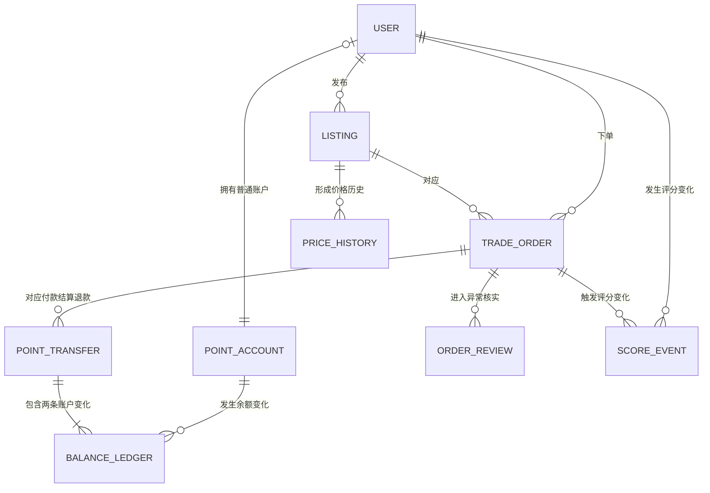

# 交易模块 E-R 与关系模式（个人草案）

> 负责成员：季鼎凯  
> 当前决定：托管演示积分使用**平台专用积分账户**；`User`、`Listing` 尚无小组定稿。  
> 状态：用于与组员讨论的逻辑模式，不是最终建表 SQL。依据：[购买规则](./购买规则.md)、[数据元素表](./交易模块_数据元素表草案.md)、[积分流水设计](./交易模块_积分流水设计草案.md)、[价格历史设计](./交易模块_价格历史设计草案.md)。

## 1. 先看关系

`USER`、`LISTING` 只表示与其他组员的接口，不在这份草案中替他们确定完整字段。平台托管账户没有普通用户所有者，因而不受 `USER` 到 `POINT_ACCOUNT` 的普通账户联系限制。图中的 `POINT_TRANSFER` 是把一次积分转移的公共信息抽出来，`BALANCE_LEDGER` 再记录转出与转入两侧。

## 2. 候选关系模式

| 关系 | 候选字段（主键以 **PK** 标注） | 作用与约束 |
| --- | --- | --- |
| `User`（组员接口） | `user_id` **PK**；其他字段待小组定 | 买家、卖家、管理员的身份来源；同一用户可以既买又卖 |
| `Listing`（组员接口） | `listing_id` **PK**，`seller_id` → `User`，`current_price_points`，`status` | 商品当前价格和状态；卖家归属在交易期间不可改变 |
| `TradeOrder`（对应选题文件的 `Order`） | `order_id` **PK**，`listing_id` → `Listing`，`buyer_id` → `User`，`price_snapshot_points`，`status`，`created_at`，`payment_deadline_at`，`paid_at`，`delivered_at`，`auto_complete_at`，`completed_at`，`completion_method`，`canceled_at`，`cancel_reason` | 保存一次下单及关键时间；同一商品可有多个历史订单，但至多一笔有效订单 |
| `PointAccount` | `account_id` **PK**，`owner_type`，`user_id` → `User`（平台账户为空），`balance_points` | 每个用户一个普通账户，另有一个平台专用托管账户；余额非负 |
| `PointTransfer` | `transfer_id` **PK**，`order_id` → `TradeOrder`，`event_type`，`occurred_at` | 一次付款、结算或退款的公共记录；同一订单的每种事件最多一次 |
| `BalanceLedger` | `ledger_id` **PK**，`transfer_id` → `PointTransfer`，`account_id` → `PointAccount`，`delta_points` | 一次转移对应转出、转入各一行；两行变动量之和为 0 |
| `PriceHistory` | `history_id` **PK**，`listing_id` → `Listing`，`price_points`，`change_type`，`changed_at` | 首次挂牌一行，以后每次成功改价追加一行；历史不可覆盖 |
| `OrderReview` | `review_id` **PK**，`order_id` → `TradeOrder`，`reason`，`previous_status`，`opened_at`，`decision`，`resolved_at`，`admin_id` → `User` | 记录取消申请、未收到反馈、卖家交付超时及管理员核实；同一订单同时最多一项未结束核实 |
| `ScoreEvent` | `score_event_id` **PK**，`order_id` → `TradeOrder`，`user_id` → `User`，`score_type`，`reason`，`delta_score`，`occurred_at`，`operator_id` → `User`（系统自动时可为空） | 买家奖励与卖家信誉分的变动记录；与可购买的演示积分流水分开 |

这是**逻辑候选**，字段类型、表名、索引与空值规则要等小组确定数据库模式后再落实。`TradeOrder` 采用这个名字，是为避免 SQL 中的 `ORDER` 关键字；报告仍可称“订单 Order”。

## 3. 几个容易混淆的地方

1. **订单不复制卖家个人信息。** 假设 `Listing.seller_id` 在订单存续期间不变，订单通过 `listing_id` 就能找到卖家；姓名、联系方式由 `User` 提供。若小组允许商品转让所有权，才需要另议卖家快照。
2. **一次转移与两条流水分开。** `PointTransfer` 存订单、事件类型和时间；`BalanceLedger` 只存哪个账户增减多少。这样同一次转移的公共信息不会在两条流水里重复。一次付款：买家 `−价款`、平台 `+价款`；一次结算：平台 `−价款`、卖家 `+价款`；一次退款：平台 `−价款`、买家 `+价款`。
3. **一个平台托管账户可服务多订单。** 其余额应等于所有已付款、未结算且未退款订单的价格快照之和。每笔订单仍凭 `PointTransfer.order_id` 追溯自己的积分去向。
4. **评分不是付款余额。** 买家完成交易奖励、卖家完成交易加分、核实卖家超时扣分进入 `ScoreEvent`；付款后显示“待生效奖励”无需预先记一笔评分。
5. **当前价、历史价、订单价不同。** `Listing.current_price_points` 是现价，`PriceHistory.price_points` 是历次生效挂牌价，`TradeOrder.price_snapshot_points` 是下单锁定的价。建议价放在估价组的 `Valuation`，不写进价格历史。

## 4. 主键、唯一性和状态约束候选

- 每个普通用户最多一个 `PointAccount`；平台托管账户恰好一个。账户类型与 `user_id` 的空值应互相匹配。
- `TradeOrder` 对同一商品最多有一笔处于“待付款、待交付、待收货、待核实”的有效订单。已取消、支付超时、已完成订单保留历史；过期但未清理的待付款订单先在事务中清理，再创建新订单。
- `PointTransfer` 对 `(order_id, event_type)` 唯一；事件类型为 `PAYMENT`、`SETTLEMENT`、`REFUND`。一个转移有且仅有两个不同账户的 `BalanceLedger` 行，合计变动为零；后一条约束要靠写入事务检查，不能只凭单行 `CHECK` 完成。
- `PriceHistory` 每个商品恰有一条首次挂牌 `INITIAL`；后续 `REPRICE` 只追加。`Listing.current_price_points` 与该商品最后一次成功改价的价格一致，发布和改价在同一事务中更新。
- `ScoreEvent` 用“订单＋评分类型＋原因”防止同一订单重复发买家奖励、卖家完成加分或卖家超时处罚。具体数值仍按购买规则的个人草案，待小组确认。
- `ScoreEvent.delta_score` 记录上下限作用后**实际增加或减少的分数**。例如卖家信誉已到 100 分，再完成一单可记录一次加分事件但实际变动为 0，以便同时解释上限和防止重复触发。
- `OrderReview` 同一订单同时最多有一条未结束核实。订单为“待核实”时，必须能找到对应的未结束核实记录；管理员结论、退款和状态恢复应在同一事务提交。

## 5. 为什么这样拆：3NF 初步检查

| 函数依赖 | 容易犯的错 | 本草案的处理 |
| --- | --- | --- |
| `listing_id → seller_id` | 在订单里再存卖家姓名、联系方式，产生与商品和用户资料不一致的副本 | `TradeOrder` 只存 `listing_id`，经 `Listing` 找卖家 |
| `transfer_id → order_id, event_type, occurred_at` | 每条转出／转入流水都重复事件类型和时间 | 将共同信息放入 `PointTransfer` |
| `ledger_id → transfer_id, account_id, delta_points` | 一行流水同时放买家余额、卖家余额和平台余额 | 每行只描述一个账户的一次变化 |
| `history_id → listing_id, price_points, change_type, changed_at` | 把所有旧价放在商品的一列或覆盖旧价 | 每次生效价格单独追加历史行 |

`PriceHistory` 旧草案中的 `changed_by` 是审计候选。若第一版严格规定只有商品卖家能改价，操作人可由 `Listing.seller_id` 推得，核心 3NF 模式暂不重复保存；若以后允许管理员代改并需要追责，再增加真实操作人字段。`PointAccount.balance_points` 是为快速查询维护的账户当前值，须与流水在同一事务更新并定期核对；它不是某一条流水的属性。

## 6. 下一步对接与实现顺序

1. 与商品组确认 `Listing.seller_id` 是否固定、商品状态取值、当前价字段，以及支付占用和缓冲期由谁维护。
2. 与用户组确认 `User.user_id` 与积分账户的关系，平台专用账户如何初始化，买家奖励／卖家信誉当前分数是否放在 `User` 或另设评分账户。
3. 对齐这些接口后，画小组认可的 E-R 图，检查每个外键、唯一约束及 3NF，再编写 PostgreSQL `CREATE TABLE`。
4. 付款事务已在日常演示库核对；下单／到期、交付／结算、退款、改价函数已在隔离 PostgreSQL 测试库实跑，两个连接争抢商品、重复结算及反馈与自动结算竞争也已验证，见[阶段检查说明](./README_交接必读.md)。下一步仍需与组员对齐表结构、接入调度器与页面，并扩展其他并发交错测试。

当前已整理[独立 PostgreSQL 建表草案](./交易模块_独立建表草案.sql)，使用 `trade_demo` schema 和最小用户／商品占位表，供讨论主键、外键、`CHECK` 及唯一索引；已于 2026-11-13 在本机 PostgreSQL 18.7 的 `hangxiaoyu_trade_demo` 演示库实跑通过，但不能当作小组最终模式。

[独立初始化与核对脚本](./交易模块_独立初始化与核对.sql)已在同一演示库首次运行，建立一笔 100 积分商品的演示起点，并核对买家、卖家、平台托管余额及首条价格历史；结果见[首次运行记录](./README_交接必读.md)。

## 7. 可发给组员核对的摘要

> 我负责的交易模块目前有个人版 E-R 与关系模式草案，托管演示积分采用平台专用 `PointAccount`。需要与你们确认：`User` 的主键和积分账户如何关联；`Listing` 的卖家归属是否固定、当前价及状态字段如何命名；商品是否支持“支付占用、交易中、重新上架缓冲期”；商品发布／改价时由谁维护 `PriceHistory`。目前这些仍是接口候选，确定后我会对齐外键和约束，再写可运行的 PostgreSQL 建表及事务 SQL。
