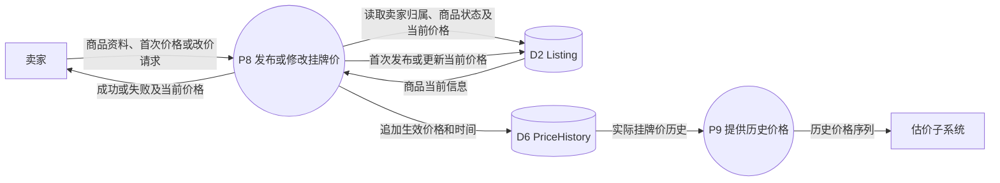

# PriceHistory 价格历史设计（个人草案）

> 项目：校园二手交易与智能估价平台「航小鱼」  
> 负责成员：季鼎凯  
> 依据：[选题阶段提交文件](./README_交接必读.md)中的“商品初次挂牌与改价历史”，以及[购买规则.md](./购买规则.md)  
> 状态：供商品模块与估价模块接口讨论；尚未与小组确认，也不是最终 SQL 表结构。

## 1. 这张历史表记录什么

`PriceHistory` 记录卖家**实际挂牌价格**的时间序列：首次发布写一条，以后每次成功改价再追加一条。智能估价程序生成的建议区间属于选题文件中的 `Valuation`，不是卖家的实际挂牌价，不写入 `PriceHistory`。最终成交价保存在 `Order` 的下单价格快照中，不能以后续改价覆盖。

例子：商品首次挂牌 120 积分，之后卖家改为 110 积分，再改为 100 积分。历史应保留 `120 → 110 → 100` 三个生效价格；商品当前价为 100。若此时买家以 100 下单，订单价格快照为 100，后续历史变化也不修改该订单。

## 2. `PriceHistory` 候选数据元素

| 数据元素 | 含义 | 当前建议 |
| --- | --- | --- |
| 历史编号 `history_id` | 唯一标识一条挂牌或改价记录 | 主键；也可用于同一时间戳下的稳定排序 |
| 商品编号 `listing_id` | 哪个商品的价格 | 外键，关联 `Listing`；一个商品对应多条历史 |
| 生效价格 `price_points` | 本次操作完成后的挂牌演示积分 | 正整数；采用整数积分的前提需小组确认 |
| 操作类型 `change_type` | 首次挂牌或后续改价 | 可取 `INITIAL`、`REPRICE`；一个商品只能有一条首次挂牌记录 |
| 操作人编号 `changed_by` | 谁执行发布或改价 | 审计候选：第一版仅允许卖家时可由 `Listing.seller_id` 推得，核心 3NF 模式暂不重复保存；若允许管理员代改再存入 |
| 生效时间 `changed_at` | 本次价格实际提交的时间 | 使用数据库服务器时间；与历史编号共同确定顺序 |

此草案只保存**每次生效后的价格**。上一次价格可从该商品的前一条历史得到，避免在同一行同时保存“旧价”和“新价”而产生两份可能不一致的数据。若报告或审计明确要求保留旧价，可在关系模式设计时再讨论。

`Listing` 中仍可保留当前价格，供商品列表和下单快速读取；它必须等于该商品最新一条 `PriceHistory.price_points`。这是当前值与历史记录之间需要维护的一致性约束。

## 3. 初次挂牌与改价流程



商品发布和改价都必须把 `Listing` 当前价格与 `PriceHistory` 新记录放在**同一次数据库事务**中提交；任一步失败，两边都回滚。可以用原生 SQL 事务或数据库触发器实现，但只能有一个明确的写入路径，避免一次改价生成两条历史。

订单子系统下单时读取 `Listing` 当前价格并保存订单价格快照；它不直接改写 `PriceHistory`。图中的 P8、P9 是跨商品与估价模块的逻辑过程，最终由哪位组员实现须协商。

## 4. 改价限制与并发

1. 卖家只能修改自己的商品；账号或商品被管理员限制时拒绝改价。
2. 新价格必须为正整数，且与当前价格不同；失败、无变化或事务回滚时均不追加历史。
3. 商品处于“支付占用”“交易中”“已售”时拒绝改价。处于“在售”时允许；已付款取消后的“重新上架缓冲期”可允许卖家检查后改价，但商品仍不可被购买。是否也允许“下架”状态改价，须与商品模块确认。
4. 改价与买家下单都必须读取并锁定同一商品当前行，保证顺序：若改价先提交，买家下单看到新价格，原页面旧价须重新确认；若下单先占用商品，改价失败。订单价格快照始终取下单成功时的价格。
5. 两次改价同时发生时，应按数据库提交顺序逐次检查当前价格并追加历史；历史行不可覆盖或删除，需纠错时再写新的修正记录。

## 5. 与组员对接的边界

| 对接方 | 需要确认的内容 |
| --- | --- |
| 商品模块 | 谁负责 `Listing` 当前价格与状态；发布、改价、缓冲期改价使用哪些原生 SQL 操作；是否允许下架状态改价 |
| 订单模块 | 下单事务读取的必须是商品当前价格，并立即保存 `Order` 价格快照；占用后禁止卖家改价 |
| 估价模块 | `PriceHistory` 提供实际挂牌价序列；`Valuation` 另存建议区间、样本量与算法版本，不把建议价当成真实改价 |

## 6. 改价与下单同时发生的两种结果

商品当前在售价格 120，卖家提交改价为 110，买家页面仍显示 120 并点击下单：

| 先完成的事务 | 商品与价格历史 | 买家订单 |
| --- | --- | --- |
| 卖家改价 | 商品当前价 110；`PriceHistory` 追加 110 | 买家看到的 120 已过期，须重新确认 110；这次请求不创建订单 |
| 买家下单 | 商品进入支付占用；当前价仍 120；不追加 110 的历史 | 创建待付款订单，订单价格快照为 120；卖家此次改价被拒绝 |

## 7. 翻译成 PostgreSQL 事务骨架

下面是**讲解步骤的 SQL 草案**：`listing`、`orders`、`price_history`、字段名和 `:参数` 尚未与小组定稿，`-- 检查`处由后端读取查询结果并决定继续或 `ROLLBACK`，不能把代码块原样当作已可运行的最终 SQL。两条事务都先锁定同一条 `Listing`，在 PostgreSQL 中 `SELECT ... FOR UPDATE` 会使竞争者等待当前事务结束，再取得可用于继续检查的行。[PostgreSQL 行锁说明](https://www.postgresql.org/docs/current/explicit-locking.html)

**卖家改价事务：**

```sql
BEGIN;
SELECT seller_id, status, current_price
FROM listing
WHERE listing_id = :listing_id
FOR UPDATE;

-- 检查：操作人是卖家；状态允许改价；新价 > 0；
-- 当前价仍等于卖家页面提交的旧价，且新价不同于旧价。
-- 任一条件失败：ROLLBACK，返回最新价格与失败原因。

UPDATE listing
SET current_price = :new_price
WHERE listing_id = :listing_id;
INSERT INTO price_history
    (listing_id, price_points, change_type, changed_at)
VALUES (:listing_id, :new_price, 'REPRICE', clock_timestamp());
COMMIT;
```

**买家下单事务：**

```sql
BEGIN;
SELECT seller_id, status, current_price
FROM listing
WHERE listing_id = :listing_id
FOR UPDATE;

-- 检查：商品仍在售；买家不是卖家；当前价等于买家页面确认的价格。
-- 若价格变化：ROLLBACK，返回最新价格，请买家重新确认。
-- 锁定商品之后取一次数据库时间，作为本单下单时间 :created_at。
SELECT clock_timestamp() AS created_at;

INSERT INTO orders
    (listing_id, buyer_id, price_snapshot, status,
     created_at, payment_deadline_at)
VALUES
    (:listing_id, :buyer_id, :confirmed_price, 'PENDING_PAYMENT',
     :created_at, :created_at + INTERVAL '5 minutes')
RETURNING order_id;

-- 读取上一步返回的 order_id，再用于占用当前商品。
UPDATE listing
SET status = 'PAYMENT_RESERVED', reserved_order_id = :order_id
WHERE listing_id = :listing_id;
COMMIT;
```

`clock_timestamp()` 可以在等待行锁后取得实际服务器时间；PostgreSQL 的 `now()` 则固定为事务开始时刻，事务曾等待锁时可能不适合直接作为“下单成功”的时间。[PostgreSQL 日期时间函数说明](https://www.postgresql.org/docs/current/functions-datetime.html)

首次发布商品时，也应在一个事务中插入 `Listing` 与一条 `INITIAL` 价格历史。无论哪条事务出错，只要 `ROLLBACK`，都不能留下“商品价已改但历史没写”或“订单已建但商品未占用”的半成品。支付占用过期的清理逻辑见[购买规则.md](./购买规则.md)，此处只展示在售商品与改价竞争的核心路径。
