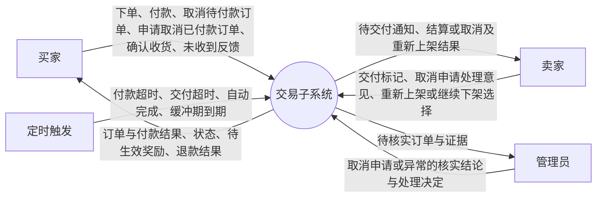
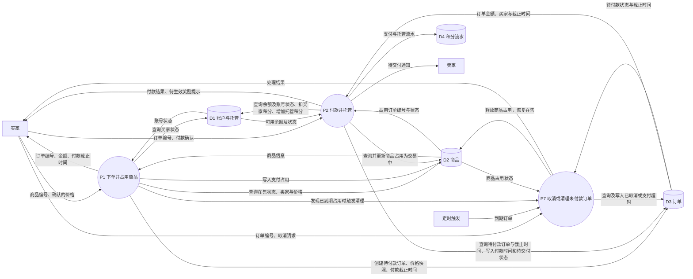
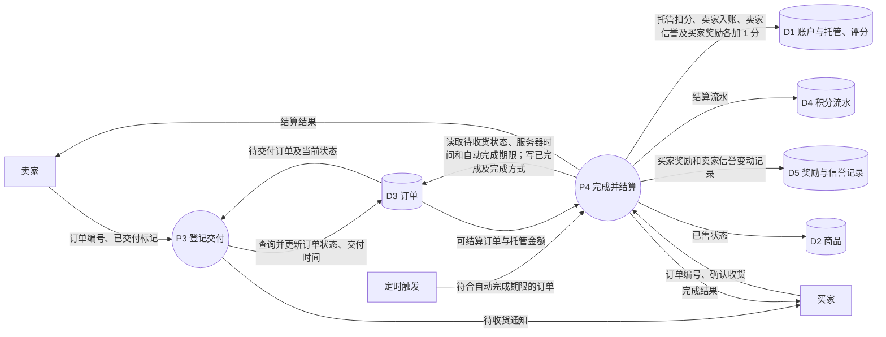
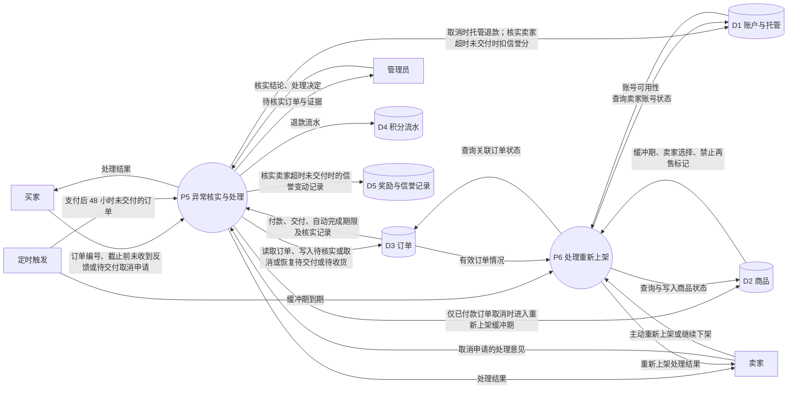

# 交易模块数据流图（个人草案）

> 项目：校园二手交易与智能估价平台「航小鱼」  
> 负责成员：季鼎凯  
> 依据：[购买规则.md](./购买规则.md)  
> 状态：用于需求分析讨论，尚未与小组确认；图中的数据存储是逻辑概念，不代表最终一定要建同名表。

## 1. 图的含义

- **状态图**说明订单在“待付款、待交付、待收货、待核实、已完成、已取消、支付超时”之间怎样变化。购买规则文件已有状态草图。
- **数据流图（DFD）**说明谁提交哪些数据、处理过程读写哪些数据、结果返回给谁。图中不画 SQL、数据库锁或页面按钮。

## 2. 交易子系统顶层图

“定时触发”是系统内部触发源，正式绘图时可以画在子系统边界内。

## 3. 下单与付款的数据流

P1、P2、P7 分别是原子操作；P1 发现已到期占用时，先在数据库事务中清理旧占用，再尝试新订单。P1 不写积分流水；P7 不扣积分、不退款。P2 必须自己检查付款截止时间，不能只等待 P7 的定时触发。P2 与 P7 并发时，只有一方可以改变同一待付款订单。商品价格在 P1 创建订单时锁定，P2 使用订单价格快照。

## 4. 交付与结算的数据流

P4 的订单、演示积分、流水、买家奖励、卖家信誉与商品状态更新须原子提交；买家确认与定时任务同时触发时，同一订单最多结算一次。待生效奖励只是付款后的展示状态，直到 P4 才改变买家奖励分。

## 5. 异常与重新上架的数据流

进入“待核实”后暂停交付与自动结算。买家仅在已付款、未交付时可申请取消，由管理员听取卖家意见后决定：同意则原额退款、待生效奖励作废；不同意则恢复“待交付”，原 48 小时交付期限不重置。买家反馈未收到商品须在订单仍待收货且服务器时间早于自动完成截止时间时生效；P4 自动结算须在截止时间已到且订单仍待收货时生效，两者通过数据库状态约束互斥。管理员处理其他异常时，若确认已交付且可继续，则恢复“待收货”，从核实结束重新计 24 小时自动完成期限。仅在核实卖家确实超时未交付后扣信誉分。已付款订单取消后进入不可购买的缓冲期；未付款订单取消或超时由 P7 释放商品，不走 P5、P6。

## 6. 数据存储与源文件的对应

| 图中编号 | 逻辑数据存储 | 与选题阶段实体的关系 | 主要被谁读写 |
| --- | --- | --- | --- |
| D1 | 用户账户、平台托管余额、买家奖励分、卖家信誉分 | `User` 及待确定的托管与评分表示方式 | P1、P2、P4、P5、P6 |
| D2 | 商品价格、卖家、支付占用、交易及重新上架状态 | `Listing` | P1、P2、P4、P5、P6、P7 |
| D3 | 订单、价格快照、付款截止时间、各阶段时间、异常处理结果 | `Order` | P1～P7 |
| D4 | 支付、托管、结算和退款积分流水 | `BalanceLedger` | P2、P4、P5 |
| D5 | 买家奖励与卖家信誉的变动记录 | 待确定的评分记录实体，不并入购买演示积分流水 | P4、P5 |

`PriceHistory` 由商品初次挂牌及改价流程写入，不参与收货后结算；支付占用期间卖家不得改价。跨模块的小图见[交易模块_价格历史设计草案.md](./交易模块_价格历史设计草案.md)，最终接口需与商品和估价模块组员核对。

## 7. 与组员核对的接口

1. 商品模块是否支持“支付占用”状态、占用订单编号、禁止改价、付款成功后“交易中”、未付款超时立即恢复“在售”？
2. 平台托管积分使用平台专用账户还是订单冻结金额？本图只表达积分暂存且可追溯，不预设表结构。
3. 商品模块是否支持已付款取消后的“重新上架缓冲期”、卖家“继续下架”、管理员禁止再售，以及期满自动上架？缓冲期建议 24 小时。
4. 信誉分建议初始 80 分、完成交易加 1 分、核实超时未交付扣 10 分、范围 0～100 分；买家奖励建议完成交易加 1 分。两个分值及记录方式须与小组确认。
5. 页面须能显示付款后的待生效奖励、买家待交付取消申请及管理员处理结果；待生效奖励不增加可购买演示积分。

## 8. 自检

- 图中外部参与者只连接处理过程，不直接连接数据存储。
- 下单、付款、未付款超时、已付款取消分别对应不同数据流；积分只从 P2 开始变化。
- 积分去向可追溯：买家 → 托管 → 卖家，或托管 → 买家退款。
- 重复付款、超时任务、完成、退款、买家奖励与卖家信誉分变动不会在同一订单上重复生效。
